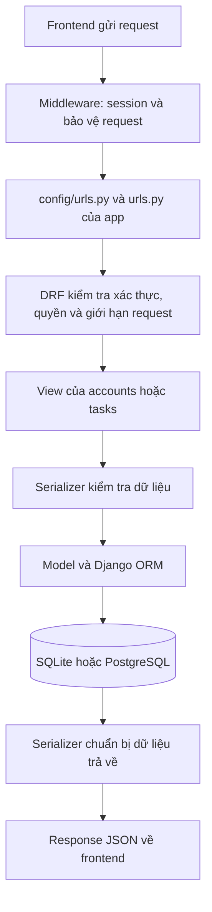

# Giải thích cấu trúc backend Todo Dashboard

Tài liệu này mô tả mã nguồn backend hiện có trong dự án. Các đường dẫn trong cây thư mục được tính từ `D:\todo-dashboard`.

## 1. Backend làm gì trong ứng dụng này?

Frontend là phần bạn nhìn thấy và bấm trên trình duyệt. Backend Django nhận yêu cầu từ frontend, kiểm tra dữ liệu và quyền truy cập, đọc hoặc ghi database rồi trả kết quả.

Ví dụ, khi bạn bấm **Done** để tạo task, giao diện gửi tiêu đề, mô tả và mức ưu tiên đến backend. Backend xác định tài khoản đang đăng nhập, lưu task cho tài khoản đó và trả task vừa tạo để giao diện hiển thị.

Một số từ sẽ gặp trong tài liệu:

| Từ | Ý nghĩa trong dự án |
| --- | --- |
| Request | Một yêu cầu gửi đến server, chẳng hạn tạo task hoặc đăng nhập |
| Response | Kết quả server trả về: dữ liệu hoặc thông báo lỗi |
| API / endpoint | Địa chỉ frontend gọi để thực hiện một chức năng, ví dụ `/api/v1/tasks/` |
| JSON | Định dạng trao đổi dữ liệu, ví dụ `{"title": "Học Django"}` |
| Model | Lớp Python mô tả dữ liệu cần lưu và quan hệ giữa các dữ liệu |
| ORM | Cơ chế của Django giúp truy vấn database bằng Python |
| Serializer | Kiểm tra, chuyển đổi dữ liệu đầu vào và chuẩn bị dữ liệu đầu ra cho API |
| View | Phần tiếp nhận request và điều phối xử lý chức năng |
| Migration | File ghi lại thay đổi cấu trúc database |
| Session | Phiên đăng nhập giúp server nhận biết người dùng ở những request tiếp theo |

## 2. Cây thư mục

```text
todo-dashboard/
├── run.bat                         # File chạy server nhanh trên Windows
├── frontend/                       # Giao diện, nằm riêng với backend
└── backend/
    ├── manage.py                   # Nhận các lệnh quản lý Django
    ├── requirements.txt            # Danh sách thư viện Python cần cài
    ├── .env.example                # Mẫu cấu hình môi trường
    ├── .env                        # Tự tạo khi cấu hình máy; hiện chưa có
    ├── db.sqlite3                  # Database local, không đưa lên Git
    ├── .venv/                      # Python và thư viện riêng của dự án
    │   ├── Scripts/                # python.exe, pip.exe, file kích hoạt...
    │   ├── Lib/site-packages/      # Thư viện đã cài bằng pip
    │   ├── Include/                # Thư mục hỗ trợ phần mở rộng Python
    │   └── pyvenv.cfg              # Thông tin môi trường ảo
    ├── config/
    │   ├── __init__.py
    │   ├── settings.py
    │   ├── urls.py
    │   ├── api.py
    │   └── wsgi.py
    ├── accounts/
    │   ├── __init__.py
    │   ├── models.py
    │   ├── managers.py
    │   ├── serializers.py
    │   ├── views.py
    │   ├── urls.py
    │   ├── admin.py
    │   ├── tests.py
    │   └── migrations/
    │       ├── __init__.py
    │       └── 0001_initial.py
    └── tasks/
        ├── __init__.py
        ├── models.py
        ├── serializers.py
        ├── views.py
        ├── urls.py
        ├── admin.py
        ├── tests.py
        └── migrations/
            ├── __init__.py
            └── 0001_initial.py
```

Các thư mục `__pycache__/` có thể xuất hiện khi chạy Python. Chúng chứa file được Python tạo để hỗ trợ tải mã nhanh hơn, được bỏ qua trong Git.

Ba nhóm mã nguồn chính:

| Thư mục | Trách nhiệm |
| --- | --- |
| `config/` | Cấu hình chung, định tuyến chính và các quy tắc dùng chung cho API |
| `accounts/` | Tài khoản, đăng nhập, hồ sơ và mật khẩu |
| `tasks/` | Công việc, phân quyền sở hữu, bộ lọc và thống kê |

`accounts` và `tasks` là hai **Django app**: mỗi app gom mã nguồn cho một nhóm chức năng. Chúng chạy trong cùng một backend và dùng chung database.

## 3. Các file ở ngoài ba nhóm chức năng

### `backend/manage.py` — chạy lệnh Django

[Mở file](../backend/manage.py).

File này chọn `config.settings` làm cấu hình mặc định rồi chuyển lệnh bạn nhập cho Django xử lý.

Ví dụ, tại thư mục `backend`:

```powershell
.\.venv\Scripts\python.exe manage.py runserver
```

Trong lệnh trên:

- `.\.venv\Scripts\python.exe`: Python thuộc môi trường của dự án.
- `manage.py`: file nhận lệnh quản lý Django.
- `runserver`: yêu cầu mở server phát triển, mặc định tại cổng `8000`.

`manage.py` cũng nhận các lệnh như `migrate`, `makemigrations`, `createsuperuser`, `test` và `check`. Logic tạo task hay đăng nhập nằm trong các app.

### `backend/requirements.txt` — các thư viện cần cài

[Mở file](../backend/requirements.txt).

| Thư viện đang khai báo | Tác dụng |
| --- | --- |
| `Django==5.2.19` | Framework chính: ORM, tài khoản, session, Admin, định tuyến... |
| `djangorestframework==3.16.1` | Xây dựng API: serializer, API view, router, quyền truy cập và phân trang |
| `psycopg[binary]==3.3.9` | Giúp Django kết nối PostgreSQL |
| `python-dotenv==1.2.4` | Đọc cấu hình từ file `.env` |

Lệnh `python -m pip install -r requirements.txt` cài các thư viện này cùng các thư viện phụ thuộc. File này giúp máy khác cài lại môi trường của dự án.

### `backend/.env.example` và `.env` — cấu hình cho từng máy

[Mở file mẫu](../backend/.env.example).

`.env.example` là mẫu được lưu trong Git. Bạn có thể sao chép nó thành `.env`, rồi chỉnh các giá trị theo máy đang chạy. Hiện dự án chưa có `.env`, nên những biến chưa được đặt sẽ dùng giá trị mặc định trong `settings.py`.

| Biến | Tác dụng |
| --- | --- |
| `DJANGO_DEBUG` | Bật chế độ phát triển khi là `True` |
| `DJANGO_SECRET_KEY` | Khóa dùng trong các cơ chế ký dữ liệu của Django |
| `DJANGO_ALLOWED_HOSTS` | Tên miền hoặc địa chỉ host mà ứng dụng chấp nhận |
| `DB_ENGINE` | Chọn `sqlite` hoặc `postgresql` |
| `DB_NAME`, `DB_USER`, `DB_PASSWORD`, `DB_HOST`, `DB_PORT` | Thông tin kết nối PostgreSQL |
| `DJANGO_CSRF_TRUSTED_ORIGINS` | Các origin HTTPS được tin cậy khi kiểm tra CSRF |

Trong cấu hình hiện tại, SQLite dùng khi chạy local với `DEBUG=True`. Khi tắt debug để chạy production, cấu hình yêu cầu PostgreSQL và khóa bí mật phù hợp. `.env` thật được bỏ qua trong Git vì có thể chứa mật khẩu kết nối.

### `backend/db.sqlite3` — dữ liệu local

Đây là file database khi dùng SQLite. Nó lưu dữ liệu như tài khoản, hash mật khẩu, task, session và lịch sử migration đã áp dụng.

Tắt server không làm mất dữ liệu đã lưu trong file này. Khi chuyển sang PostgreSQL, dữ liệu được lưu trong PostgreSQL; việc đổi cấu hình không tự chuyển dữ liệu cũ từ SQLite sang.

Đây là file dữ liệu nhị phân, thường thao tác qua Django ORM hoặc Django Admin. File được bỏ qua trong Git.

### `backend/.venv/` — môi trường Python riêng

Thư mục này chứa trình chạy Python và các thư viện của dự án. Những file bạn thấy trong ảnh VS Code thuộc nhóm này:

| File hoặc thư mục | Tác dụng |
| --- | --- |
| `Scripts/python.exe` | Chạy mã Python, chẳng hạn `manage.py runserver` |
| `Scripts/pythonw.exe` | Chạy Python theo cách không tạo cửa sổ console; dự án này dùng `python.exe` để xem log server |
| `Scripts/pip.exe`, `pip3.exe`, `pip3.10.exe` | Các lệnh cài thư viện vào môi trường |
| `Scripts/Activate.ps1` | Kích hoạt môi trường trong PowerShell |
| `Scripts/activate.bat` | Kích hoạt môi trường trong Command Prompt |
| `Scripts/activate` | Script kích hoạt dành cho shell tương thích như Bash |
| `Scripts/deactivate.bat` | Script thoát môi trường trong Command Prompt |
| `Scripts/django-admin.exe` | Lệnh quản lý Django; trong dự án này thường dùng `manage.py` vì nó đã chọn cấu hình |
| `Scripts/dotenv.exe`, `sqlformat.exe` | Công cụ đi kèm các thư viện đã cài; không cần gọi để chạy Todo |
| `Lib/site-packages/` | Chứa mã thư viện Django, DRF và các thư viện khác |
| `Include/` | Dùng cho những phần mở rộng Python cần header khi biên dịch |
| `pyvenv.cfg` | Ghi thông tin Python gốc và cấu hình môi trường ảo |

Khi gọi đầy đủ `.\.venv\Scripts\python.exe`, bạn đang chọn đúng Python của dự án mà không cần kích hoạt môi trường trước. Nhấp vào `python.exe` trong trình soạn thảo không truyền lệnh `manage.py runserver` cho nó.

### `run.bat` ở thư mục gốc — mở server nhanh

[Mở file](../run.bat).

File này chuyển vào thư mục `backend`, kiểm tra Python trong `.venv`, rồi chạy:

```text
.venv\Scripts\python.exe manage.py runserver 127.0.0.1:8000
```

Bạn có thể nhấp đúp `run.bat` trong File Explorer hoặc chạy `.\run.bat` từ terminal tại thư mục gốc. File này giả định thư viện, database và CSS đã được chuẩn bị theo [README](../README.md).

## 4. Thư mục `config/`

### `config/settings.py` — cấu hình trung tâm

[Mở file](../backend/config/settings.py).

Django đọc file này khi khởi động. Các phần quan trọng gồm:

| Phần cấu hình | Vai trò cụ thể |
| --- | --- |
| `BASE_DIR`, `FRONTEND_DIR` | Xác định vị trí `backend/` và `frontend/` |
| `load_dotenv(...)` | Đọc `.env` nếu file tồn tại |
| `INSTALLED_APPS` | Đăng ký các app của Django, DRF, `accounts` và `tasks` |
| `MIDDLEWARE` | Khai báo các lớp xử lý request/response, gồm session, CSRF và xác thực |
| `ROOT_URLCONF` | Chỉ định `config.urls` làm nơi khai báo đường dẫn chính |
| `TEMPLATES` | Cho phép Django tìm và trả `frontend/index.html` |
| `WSGI_APPLICATION` | Chỉ định `config.wsgi.application` làm ứng dụng WSGI |
| `DATABASES` | Kết nối SQLite hoặc PostgreSQL theo biến môi trường |
| `AUTH_USER_MODEL` | Chọn `accounts.User` làm model người dùng |
| `AUTH_PASSWORD_VALIDATORS` | Kiểm tra mật khẩu: độ dài, quá phổ biến, chỉ có số hoặc quá giống thông tin người dùng |
| `TIME_ZONE`, `USE_TZ` | Dùng múi giờ `Asia/Ho_Chi_Minh` và xử lý thời gian có múi giờ |
| `STATIC_URL`, `STATICFILES_DIRS` | Ánh xạ `/static/src/` và `/static/dist/` đến tài nguyên frontend |
| `STATIC_ROOT` | Nơi gom tài nguyên khi chạy `collectstatic`: `backend/staticfiles/` |
| Các biến `SESSION_*`, `CSRF_*`, `SECURE_*` | Cấu hình cookie, CSRF và HTTPS |
| `REST_FRAMEWORK` | Chọn cách xác thực, yêu cầu đăng nhập mặc định, JSON renderer, phân trang, xử lý lỗi và giới hạn request |

Ví dụ, muốn thay database thì xem `DATABASES` cùng các biến `DB_*`. Muốn hiểu vì sao API yêu cầu đăng nhập thì xem `DEFAULT_PERMISSION_CLASSES`.

### `config/urls.py` — điều phối đường dẫn chính

[Mở file](../backend/config/urls.py).

| Đường dẫn | Nơi xử lý |
| --- | --- |
| `/` | `TemplateView` trả `frontend/index.html` |
| `/admin/` | Trang quản trị Django |
| `/api/v1/auth/...` | Chuyển phần còn lại của đường dẫn sang `accounts/urls.py` |
| `/api/v1/tasks/...` | Chuyển phần còn lại sang `tasks/urls.py` |
| `/api/v1/dashboard/summary/` | Gọi trực tiếp `SummaryView` trong `tasks/views.py` |

Ví dụ, `/api/v1/auth/login/` được ghép từ tiền tố `api/v1/auth/` ở file này và `login/` ở `accounts/urls.py`.

### `config/api.py` — các quy tắc API dùng chung

[Mở file](../backend/config/api.py).

| Thành phần | Cách hoạt động |
| --- | --- |
| `SessionAuthentication` | Kế thừa xác thực session của DRF; đổi lỗi kiểm tra CSRF thành mã `csrf_failed` và thông báo tiếng Việt |
| `TaskPagination` | Chia danh sách thành 20 mục/trang; cho gửi `page_size`, tối đa 100 |
| `exception_handler()` | Chuẩn hóa các lỗi API mà DRF xử lý thành `{code, message, fields}`; đổi lỗi chưa đăng nhập và quá giới hạn sang thông báo phù hợp |
| `csrf_failure()` | Trả JSON khi Django từ chối request vì CSRF, bao gồm các auth view được bảo vệ bằng `csrf_protect` |

Ví dụ định dạng lỗi:

```json
{
  "code": "invalid_request",
  "message": "Vui lòng kiểm tra thông tin đã nhập.",
  "fields": {
    "email": ["Email này đã được đăng ký."]
  }
}
```

`fields` giúp frontend biết trường nào sai. Với cấu hình session hiện tại, chưa đăng nhập trả `403` kèm `auth_required`; sai CSRF cũng có thể trả `403` nhưng mang mã `csrf_failed`.

Hàm `exception_handler()` không chuyển mọi lỗi lập trình thành lỗi dữ liệu: nếu DRF không xử lý được lỗi, hàm trả `None` để Django tiếp tục xử lý.

### `config/wsgi.py` — điểm nối giữa web server và Django

[Mở file](../backend/config/wsgi.py).

File này chọn `config.settings`, tạo biến `application` bằng `get_wsgi_application()` và cung cấp nó cho server hỗ trợ WSGI. Có thể hiểu WSGI là quy ước để web server chuyển request cho ứng dụng Python.

Khi triển khai, server WSGI sẽ nạp `config.wsgi:application`. File này phục vụ việc khởi tạo ứng dụng; nghiệp vụ nằm trong `accounts` và `tasks`.

### `config/__init__.py`

[Mở file](../backend/config/__init__.py).

File đang để trống, đánh dấu `config` là một Python package để có thể import như `config.settings`.

## 5. Thư mục `accounts/` — tài khoản

### `accounts/models.py` — cấu trúc người dùng

[Mở file](../backend/accounts/models.py).

Khai báo `User`, kế thừa `AbstractUser` của Django. Các điểm riêng của dự án:

- Dùng `email` để đăng nhập qua `USERNAME_FIELD`, bỏ trường `username`.
- Có `name` làm tên hiển thị và `avatar_url` làm link ảnh đại diện.
- Email được trim, chuyển về chữ thường khi lưu và có ràng buộc duy nhất không phân biệt hoa thường ở database.
- Kế thừa các trường mật khẩu, quyền quản trị, trạng thái hoạt động, thời điểm tham gia và đăng nhập từ Django.

Tên bảng mặc định là `accounts_user`. Model lưu hash mật khẩu trong trường `password`; API không trả trường này cho frontend.

### `accounts/managers.py` — cách tạo tài khoản

[Mở file](../backend/accounts/managers.py).

`UserManager` được gắn vào model qua `objects = UserManager()`.

| Hàm | Tác dụng |
| --- | --- |
| `create_user()` | Chuẩn hóa email, tạo đối tượng User, gọi `set_password()` để hash mật khẩu rồi lưu vào database |
| `create_superuser()` | Đặt và kiểm tra quyền `is_staff`, `is_superuser`, sau đó gọi `create_user()` |

Lệnh `createsuperuser` dùng manager này để tạo tài khoản quản trị. Việc kiểm tra độ mạnh mật khẩu khi đăng ký API được thực hiện ở serializer trước khi gọi manager.

### `accounts/serializers.py` — dữ liệu của các API tài khoản

[Mở file](../backend/accounts/serializers.py).

| Thành phần | Nhận hoặc trả dữ liệu gì? |
| --- | --- |
| `UserSerializer` | Trả `id`, `email`, `name`, `avatar`; cho sửa tên và avatar, còn ID/email chỉ đọc |
| `RegisterSerializer` | Nhận tên, email, mật khẩu; kiểm tra email trùng và mật khẩu; tạo user qua `UserManager` |
| `LoginSerializer` | Kiểm tra định dạng dữ liệu email và mật khẩu gửi lên; việc xác thực đúng/sai nằm ở view |
| `ChangePasswordSerializer` | Kiểm tra mật khẩu hiện tại của user và tính hợp lệ của mật khẩu mới |
| `check_password()` | Gọi bộ password validator được khai báo trong `settings.py` và chuyển lỗi sang định dạng serializer |

Trường JSON `avatar` được ánh xạ đến trường model `avatar_url` bằng `source="avatar_url"`. Những trường mật khẩu chỉ phục vụ đầu vào của API.

### `accounts/views.py` — xử lý chức năng tài khoản

[Mở file](../backend/accounts/views.py).

| Thành phần | Hoạt động |
| --- | --- |
| `InvalidCredentials` | Định nghĩa lỗi `400`, mã `invalid_credentials`, khi email hoặc mật khẩu không đúng |
| `RegistrationThrottle` | Giới hạn đăng ký local 60 lượt/phút khi `DEBUG=True`; khi production dùng mức 5 lượt/giờ trong settings |
| `CsrfView` | Trả CSRF token để frontend dùng cho request ghi dữ liệu; Django thiết lập cookie CSRF trong quá trình xử lý |
| `RegisterView` | Kiểm tra dữ liệu, lưu user trong transaction, xử lý trường hợp email trùng và trả user công khai với mã `201` |
| `LoginView` | Kiểm tra dữ liệu, gọi `authenticate()` rồi `login()` để tạo session, trả thông tin user |
| `LogoutView` | Gọi `logout()` để hủy phiên đăng nhập và trả `204` |
| `MeView` | Lấy user từ `request.user`, dùng `UserSerializer` để xem hoặc sửa hồ sơ |
| `ChangePasswordView` | Kiểm tra hai mật khẩu, lưu hash mới và cập nhật session hiện tại bằng `update_session_auth_hash()` |

Đăng ký thành công chưa tự đăng nhập. Frontend sẽ đưa người dùng về form đăng nhập.

Đổi mật khẩu giữ phiên hiện tại hợp lệ; các phiên khác với thông tin xác thực cũ bị mất hiệu lực khi sử dụng tiếp.

Các decorator trên view có tác dụng:

- `csrf_protect`: bảo vệ request đăng ký và đăng nhập ngay cả khi người dùng chưa có session.
- `never_cache`: yêu cầu không cache response của các view được đánh dấu, như thông tin tài khoản hiện tại.
- `method_decorator(..., name="dispatch")`: áp dụng decorator lên điểm tiếp nhận request của class view.

Giới hạn đăng ký và đăng nhập hiện tính theo IP. Cả lượt nhập sai dữ liệu cũng được tính. Đăng nhập có mức 10 lượt/phút; thông báo quá giới hạn được đổi sang tiếng Việt ở `config/api.py`.

### `accounts/urls.py` — địa chỉ cho từng chức năng

[Mở file](../backend/accounts/urls.py).

Các đường dẫn dưới đây đã bao gồm tiền tố từ `config/urls.py`:

| Method | Đường dẫn | View |
| --- | --- | --- |
| GET | `/api/v1/auth/csrf/` | `CsrfView` |
| POST | `/api/v1/auth/register/` | `RegisterView` |
| POST | `/api/v1/auth/login/` | `LoginView` |
| POST | `/api/v1/auth/logout/` | `LogoutView` |
| GET | `/api/v1/auth/me/` | `MeView`: xem hồ sơ |
| PATCH | `/api/v1/auth/me/` | `MeView`: sửa hồ sơ |
| POST | `/api/v1/auth/change-password/` | `ChangePasswordView` |

### `accounts/admin.py` — quản trị người dùng

[Mở file](../backend/accounts/admin.py).

Đăng ký model User vào Django Admin qua `AccountAdmin`. File này quy định các cột hiển thị, cách tìm kiếm, các nhóm trường trong form và những trường dùng khi tạo tài khoản từ Admin.

Người quản trị có quyền phù hợp dùng trang `/admin/` để quản lý tài khoản. Form đăng ký của người dùng thông thường đi qua API và serializer ở trên.

### `accounts/tests.py` — kiểm thử tài khoản

[Mở file](../backend/accounts/tests.py).

Hiện có 10 test kiểm tra: yêu cầu đăng nhập, CSRF thật, đăng ký/hash mật khẩu, email trùng, hồ sơ, xoay CSRF sau login, logout, đổi mật khẩu và session, giới hạn request local/production, tạo user trong Admin.

Test tạo dữ liệu trong database kiểm thử riêng. `setUp()` xóa cache của môi trường test để số lượt request ở test trước không ảnh hưởng test sau.

### `accounts/migrations/0001_initial.py` — tạo cấu trúc bảng người dùng

[Mở file](../backend/accounts/migrations/0001_initial.py).

Migration đầu tiên ghi lại cấu trúc User, quan hệ với các nhóm/quyền của Django, manager và ràng buộc email duy nhất. Django áp dụng nó khi chạy `migrate`.

File phụ thuộc vào migration của app `auth` có sẵn trong Django vì User sử dụng các cấu trúc quyền của app đó.

### Hai file `__init__.py` của accounts

| File | Tác dụng |
| --- | --- |
| [accounts/__init__.py](../backend/accounts/__init__.py) | Đánh dấu `accounts` là Python package |
| [accounts/migrations/__init__.py](../backend/accounts/migrations/__init__.py) | Đánh dấu package chứa migration của app |

Cả hai đang để trống và không chứa xử lý nghiệp vụ.

## 6. Thư mục `tasks/` — công việc và dashboard

### `tasks/models.py` — cấu trúc task

[Mở file](../backend/tasks/models.py).

Khai báo model `Task`, mặc định tạo bảng tên `tasks_task`.

| Trường | Ý nghĩa |
| --- | --- |
| `id` | Khóa chính được Django tạo tự động |
| `owner` | Liên kết task với User sở hữu task |
| `title` | Tiêu đề, tối đa 200 ký tự |
| `description` | Mô tả; có validator giới hạn 10.000 ký tự |
| `task_date` | Ngày công việc; mặc định là ngày hiện tại theo múi giờ đã cấu hình |
| `priority` | `Moderate` hoặc `Extreme`, mặc định `Moderate` |
| `status` | `pending` hoặc `completed`, mặc định `pending` |
| `image_url` | URL ảnh HTTP/HTTPS, có thể để trống |
| `created_at` | Thời điểm tạo do backend tự điền |
| `updated_at` | Thời điểm cập nhật do backend tự điền |

`owner` là khóa ngoại: một User có nhiều Task. Nếu một user bị xóa, `on_delete=CASCADE` khiến task của user đó cũng bị xóa. Ứng dụng hiện chưa có API tự xóa tài khoản.

Phần `Meta` quy định:

- Sắp xếp task mới tạo trước, dùng ID làm tiêu chí tiếp theo.
- Index theo chủ sở hữu và mức ưu tiên, hoặc chủ sở hữu và thời điểm tạo để hỗ trợ truy vấn.
- Ràng buộc ở database để `status` và `priority` chỉ nhận các giá trị đã định nghĩa.

### `tasks/serializers.py` — dữ liệu task và bộ lọc

[Mở file](../backend/tasks/serializers.py).

`TaskSerializer` kiểm tra dữ liệu tạo/sửa task và chuẩn bị thông tin task để trả về. Nó kế thừa `ModelSerializer`, nên tận dụng cấu trúc và validator của model.

Hai ánh xạ tên trường giúp phù hợp với frontend:

| Trong JSON | Trong model/database |
| --- | --- |
| `date` | `task_date` |
| `image` | `image_url` |

`id`, `created_at`, `updated_at` chỉ đọc. `owner` không có trong danh sách trường nhận từ client; view sẽ tự gán người đang đăng nhập khi tạo task.

`TaskFilterSerializer` kiểm tra các tham số `priority` và `status` trên URL danh sách. Ví dụ `?status=done` bị từ chối vì trạng thái hợp lệ là `pending` hoặc `completed`.

### `tasks/views.py` — CRUD và thống kê

[Mở file](../backend/tasks/views.py).

`TaskViewSet` kế thừa `ModelViewSet` của DRF nên có sẵn các hành vi CRUD. Dự án bổ sung hai phần chính:

| Hàm | Tác dụng |
| --- | --- |
| `get_queryset()` | Lấy task thuộc `request.user`; nếu đang lấy danh sách thì kiểm tra và áp dụng bộ lọc |
| `perform_create()` | Gọi `serializer.save(owner=request.user)` để gán chủ sở hữu trên server |

Dòng cốt lõi của quyền truy cập là:

```python
Task.objects.filter(owner=self.request.user)
```

Các thao tác lấy chi tiết, sửa, xóa đều tìm task trong tập dữ liệu này. Vì vậy user A tự đổi ID trên URL cũng không truy cập được task của B; kết quả là `404`.

Các hàm CRUD được kế thừa:

| Hành vi | Hàm của ViewSet | Request |
| --- | --- | --- |
| Liệt kê task | `list()` | `GET /api/v1/tasks/` |
| Tạo task | `create()` | `POST /api/v1/tasks/` |
| Xem một task | `retrieve()` | `GET /api/v1/tasks/{id}/` |
| Sửa một phần task | `partial_update()` | `PATCH /api/v1/tasks/{id}/` |
| Xóa task | `destroy()` | `DELETE /api/v1/tasks/{id}/` |

`http_method_names` giới hạn các HTTP method được dùng. Bản hiện tại dùng `PATCH` để sửa và không mở `PUT`. Nút **Finish** cũng dùng PATCH, gửi `{"status": "completed"}`.

`SummaryView` dùng `Count` và `Q` để đếm tổng task, số đang làm và số đã hoàn thành của user hiện tại trong database. API trả dạng:

```json
{"total": 10, "pending": 7, "completed": 3}
```

Thống kê dựa trên toàn bộ task của user, độc lập với trang danh sách hoặc bộ lọc đang hiển thị. Hai view đều dùng `never_cache`.

### `tasks/urls.py` — tự tạo đường dẫn CRUD

[Mở file](../backend/tasks/urls.py).

File này tạo `SimpleRouter` và đăng ký `TaskViewSet`. Router tự tạo các đường dẫn danh sách và chi tiết từ ViewSet, nên không cần viết một `path()` riêng cho từng thao tác CRUD.

Tiền tố `/api/v1/tasks/` đến từ `config/urls.py`. Đường dẫn thống kê `/api/v1/dashboard/summary/` cũng được khai báo trực tiếp ở `config/urls.py`.

Ví dụ gọi danh sách:

```text
/api/v1/tasks/?priority=Extreme&status=pending&page=1
```

Response có các trường `count`, `next`, `previous`, `results`. `count` là tổng số task khớp bộ lọc; `results` chỉ chứa task của trang đang lấy.

### `tasks/admin.py` — quản trị task

[Mở file](../backend/tasks/admin.py).

Đăng ký `TaskAdmin` để quản trị task tại `/admin/`. Có các cột tiêu đề, người sở hữu, mức ưu tiên, trạng thái và ngày công việc; hỗ trợ lọc và tìm kiếm. Hai trường thời điểm tạo/cập nhật được đặt chỉ đọc trong Admin.

### `tasks/tests.py` — kiểm thử công việc

[Mở file](../backend/tasks/tests.py).

Hiện có 7 test kiểm tra CRUD, trường do server quản lý, quyền truy cập giữa hai tài khoản, phân trang/bộ lọc/thống kê, validation, ngày mặc định theo giờ Việt Nam, ràng buộc database và cách phục vụ trang frontend. Một test có thể kiểm tra nhiều tình huống liên quan.

### `tasks/migrations/0001_initial.py` — tạo cấu trúc bảng task

[Mở file](../backend/tasks/migrations/0001_initial.py).

Ghi cấu trúc bảng Task, các index, ràng buộc trạng thái/mức ưu tiên và khóa ngoại đến User. Migration này phụ thuộc vào model người dùng qua `swappable_dependency(settings.AUTH_USER_MODEL)` để Django tạo cấu trúc tài khoản trước cấu trúc task liên quan.

### Hai file `__init__.py` của tasks

| File | Tác dụng |
| --- | --- |
| [tasks/__init__.py](../backend/tasks/__init__.py) | Đánh dấu `tasks` là Python package |
| [tasks/migrations/__init__.py](../backend/tasks/migrations/__init__.py) | Đánh dấu package chứa migration của app |

Cả hai đang để trống.

## 7. Một request đi qua những file nào?

Sơ đồ dưới mô tả luồng xử lý API ở mức tổng quát. Các bước kiểm tra không đạt sẽ trả lỗi sớm.



### Ví dụ A: đăng ký tài khoản

1. Frontend lấy CSRF token từ `CsrfView`, rồi gửi `POST /api/v1/auth/register/`.
2. Các file URL dẫn request đến `RegisterView`; lớp bảo vệ kiểm tra CSRF và giới hạn request.
3. `RegisterSerializer` kiểm tra tên, email, email trùng và mật khẩu.
4. Serializer gọi `User.objects.create_user()` trong `accounts/managers.py`.
5. Manager hash mật khẩu rồi lưu User vào database.
6. `UserSerializer` chuẩn bị thông tin công khai; view trả `201` và frontend chuyển sang form đăng nhập.

### Ví dụ B: đăng nhập rồi tải lại trang

1. Frontend gửi email, mật khẩu và CSRF token đến `LoginView`.
2. `LoginSerializer` kiểm tra đầu vào; `authenticate()` xác thực tài khoản.
3. `login()` tạo session. Trình duyệt giữ cookie phiên do server gửi về.
4. Các request tiếp theo gửi cookie để Django xác định `request.user`.
5. Khi tải lại trang, frontend gọi `/api/v1/auth/me/`; `MeView` trả thông tin tài khoản để khôi phục giao diện.

CSRF token có thể được xoay khi đăng nhập. Phần gọi API ở frontend đã xử lý lấy token mới cho những request ghi tiếp theo.

### Ví dụ C: tạo một task

Frontend gửi:

```http
POST /api/v1/tasks/
Content-Type: application/json
X-CSRFToken: <token hợp lệ>
```

```json
{
  "title": "Học Django",
  "description": "Đọc phần models và serializers",
  "priority": "Extreme"
}
```

1. Router chuyển request đến hành vi `create()` của `TaskViewSet`.
2. DRF kiểm tra người dùng đã đăng nhập và CSRF hợp lệ.
3. `TaskSerializer` kiểm tra dữ liệu.
4. `perform_create()` gán `owner=request.user` rồi lưu Task.
5. Vì không gửi `date` và `status`, model dùng ngày hiện tại và trạng thái `pending`.
6. API trả `201` cùng task vừa tạo; frontend tải lại danh sách và thống kê.

### Ví dụ D: đánh dấu hoàn thành

Frontend gửi `PATCH /api/v1/tasks/42/` với `{"status": "completed"}`. View tìm task 42 trong dữ liệu của user, serializer kiểm tra trạng thái rồi cập nhật database. Nếu task 42 thuộc người khác, quá trình dừng với `404`.

## 8. Khi muốn sửa chức năng, nên tìm file nào?

| Muốn làm gì? | File cần xem |
| --- | --- |
| Đổi database, múi giờ hoặc cấu hình môi trường | `config/settings.py`, `.env` |
| Thêm đường dẫn cấp ứng dụng | `config/urls.py` |
| Thêm thông tin cần lưu cho tài khoản | `accounts/models.py`, sau đó serializer, view nếu cần và migration |
| Đổi cách kiểm tra email hoặc mật khẩu | `accounts/serializers.py`, `AUTH_PASSWORD_VALIDATORS` trong settings |
| Đổi giới hạn đăng ký local | `RegistrationThrottle` trong `accounts/views.py` |
| Đổi giới hạn đăng nhập hoặc đăng ký production | `DEFAULT_THROTTLE_RATES` trong `config/settings.py` |
| Thêm dữ liệu cần lưu cho task | `tasks/models.py`, `tasks/serializers.py` và migration |
| Sửa quyền truy cập task | `TaskViewSet.get_queryset()` và `perform_create()` trong `tasks/views.py` |
| Thêm điều kiện lọc danh sách | `TaskFilterSerializer` trong `tasks/serializers.py` và phần áp dụng bộ lọc trong view |
| Đổi số task mỗi trang | `TaskPagination` trong `config/api.py` |
| Đổi cách tính dashboard | `SummaryView` trong `tasks/views.py` |
| Đổi thông báo lỗi API chung | `config/api.py` |
| Đổi cột hoặc form trong trang quản trị | `accounts/admin.py`, `tasks/admin.py` |
| Đổi màu sắc, bố cục, form trên giao diện người dùng | Các file trong `frontend/` |

`backend/.../views.py` xử lý request và trả dữ liệu. Các file `frontend/src/views/*.js` tạo HTML để hiển thị. Hai nhóm có tên gần giống nhau nhưng đảm nhiệm các phần khác nhau.

Khi thay đổi model cần đổi cấu trúc database, tạo và áp dụng migration mới:

```powershell
cd D:\todo-dashboard\backend
.\.venv\Scripts\python.exe manage.py makemigrations
.\.venv\Scripts\python.exe manage.py migrate
```

`makemigrations` tạo file mô tả thay đổi. `migrate` thực hiện thay đổi đó trên database. Việc chỉ sửa `models.py` chưa cập nhật cấu trúc database.

## 9. Các lệnh thường dùng

Các lệnh trong bảng chạy tại `D:\todo-dashboard\backend`.

| Lệnh | Mục đích |
| --- | --- |
| `.\.venv\Scripts\python.exe manage.py runserver` | Mở server local |
| `.\.venv\Scripts\python.exe manage.py check` | Kiểm tra cấu hình và cấu trúc Django |
| `.\.venv\Scripts\python.exe manage.py makemigrations` | Tạo migration cho thay đổi model |
| `.\.venv\Scripts\python.exe manage.py migrate` | Áp dụng migration vào database |
| `.\.venv\Scripts\python.exe manage.py showmigrations` | Xem migration nào đã được áp dụng |
| `.\.venv\Scripts\python.exe manage.py createsuperuser` | Tạo tài khoản quản trị |
| `.\.venv\Scripts\python.exe manage.py test accounts tasks` | Chạy kiểm thử backend |
| `.\.venv\Scripts\python.exe manage.py shell` | Mở Python shell có nạp sẵn môi trường Django để làm việc với model |
| `.\.venv\Scripts\python.exe manage.py collectstatic` | Gom tài nguyên vào `backend/staticfiles/` để phục vụ khi triển khai |

Nếu mới đọc code, có thể theo thứ tự: `config/urls.py` → `tasks/urls.py` → `tasks/views.py` → `tasks/serializers.py` → `tasks/models.py`, rồi chuyển sang các file tương ứng trong `accounts/`.
